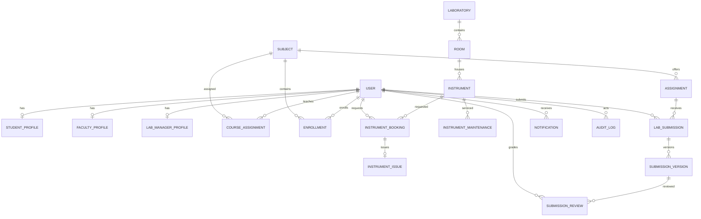
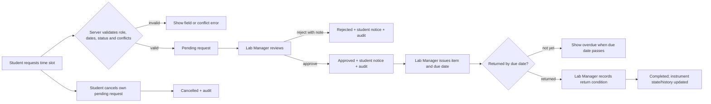

# LabVault Product Specification — Four-Role Phase

**Product:** LabVault Laboratory Equipment and Resource Management System
**Repository:** `E:\labvault`
**Specification status:** Proposed development-phase baseline, grounded in the repository inspected on 2026-11-09
**Application to preserve:** Django 5.2 modular monolith (`core`, `accounts`, `resources`) with Django templates, HTML/CSS and vanilla JavaScript

## 1. Purpose and scope

This phase grows LabVault from its current student/administrator application into four clearly separated portals: Student, Faculty, Lab Manager, and System Administrator. It formalizes responsibilities already partially represented in the code, fills the missing academic and physical-lab relationships, and applies authorization at the server and queryset level.

This is a product specification, not a claim that these features are implemented. The system remains one Django application. The Flask package, Next.js frontend, and Express backend are legacy or dormant and are not part of the implementation target.

### Verified starting point

Repository inspection confirms:

- `accounts.User` currently defines `student` and `administrator` role values, email login, and student/admin convenience properties. Registration explicitly creates students.
- `resources` already contains `Resource`, `ResourceFiles`, `Category`, `Subject`, resource-subject relationships, and access logs.
- Equipment workflows already have `Instrument`, `InstrumentBooking`, `InstrumentIssue`, and `InstrumentMaintenance`. Instruments have a unique `asset_id`, but room/location is currently a text field; there is no Room entity.
- `LabSubmission` already stores the student, resource, file metadata/hash, status, grade, feedback, reviewer, and timestamps. It does not have course assignment/enrollment or version history relationships.
- `Notification` and `AuditLog` models exist. The audit model currently has actor/action/entity/timestamp fields; the phase must verify coverage and extend safely where required.
- The active UI is server-rendered Django templates. The approved visual system is to be retained.
- Environment settings support SQL Server through `mssql-django` and optional Azure Blob Storage. This is configuration support, not evidence of live Azure connectivity.

Prior QA reported 109 passing tests and successful local browser checks of the current student/admin workflows. The implementation agent must rerun the suite and inspect present code before changing anything; reported results are a baseline, not proof for the new phase.

## 2. Product principles and fixed decisions

1. A user has exactly one LabVault application role: `student`, `faculty`, `lab_manager`, or `admin`.
2. Public self-registration creates student accounts only. Other roles are provisioned by an authorized administrator. Provisioned accounts use a temporary credential and must change it before using protected pages.
3. Lab Managers alone decide routine booking requests and alone record equipment issue and return.
4. Faculty alone grade and request academic resubmission, and only within assigned courses.
5. Faculty booking visibility is read-only and limited to assigned courses.
6. Admin is the platform-governance role, not the routine inventory operator. An emergency booking override requires a written reason, is audited, and notifies the Lab Manager. Emergency equipment deactivation is audited.
7. Role permissions are fixed in application code and shown read-only in the admin portal. Admins may configure validated operational policy values, not arbitrary permission rules.
8. Do not hard-delete users, equipment, bookings, submissions, or history-bearing records through routine workflows. Deactivate or archive them. Retain existing cascade behavior only where it is safe and history-preserving.
9. Preserve the existing visual design. No visual redesign, gratuitous animation, fabricated metrics, placeholder controls, AI features, AI branding, or AI-related user-facing wording.
10. Azure account access, resource provisioning, login, and deployment are out of scope. Preserve the existing integration code and keep local settings usable without Azure credentials.

## 3. Roles and responsibilities

### Student Portal

Students use equipment and complete coursework. They can view their own dashboard and records; search equipment and public/enrolled-course resources; request and track bookings; cancel their own eligible pending request; view issued and overdue items and history; submit and, when requested, resubmit work; see their grades and feedback; manage their own profile; and read/mark their own notifications.

Students cannot see other students' private records, internal equipment notes, maintenance history, user lists, course rosters outside their own enrollment, or make operational or grading decisions.

### Faculty Portal

Faculty supervise assigned courses. They can see their courses, enrolled students, course sessions, relevant resources and read-only course-related booking/issue activity; review submissions; grade and provide feedback; request resubmission with a reason; inspect submission history and course progress; manage resources assigned to their courses; export course grades; and receive academic notifications.

Every Faculty list, dashboard count, export, detail page, download, and mutation is constrained to courses assigned to the current Faculty member. Faculty cannot approve bookings, issue or return equipment, manage inventory, alter accounts, view global audit logs, or access unrelated courses/students.

### Lab Manager Portal

Lab Managers operate physical laboratories. They manage serialized instrument records, rooms and allocations; inspect all booking requests; approve or reject bookings with a decision note; issue approved equipment and record due dates; record returns and condition; manage maintenance and inspections; view operational schedules and utilization; export operational reports; and receive booking, return, overdue, availability, and maintenance notifications.

Lab Managers cannot manage users or roles, change global configuration, read global security audit logs, grade work, or edit academic course/enrollment data.

### System Administrator Portal

Administrators govern the platform. They manage accounts and activation, assign the four fixed roles, manage departments, subjects/courses, faculty assignments and student enrollments, configure validated operational policies, inspect system-wide summaries, view/export audit and security events, and export system-wide reports. They have read-only oversight of grades and inventory. Any emergency booking override or equipment deactivation requires a reason and audit event.

Administrators cannot silently edit academic grades or routinely perform Lab Manager actions. Protect against self-demotion and deactivation/demotion of the last active administrator.

## 4. Permission matrix

Legend: **V** view, **C** create, **U** update, **A** approve/decide, **X** deactivate/archive (not hard delete), **E** export, **own** current user's records, **course** assigned courses. All actions require backend enforcement and scoped querysets. “Public fields” excludes internal notes, maintenance details, and security-sensitive asset information.

| Feature | Student | Faculty | Lab Manager | Admin |
|---|---|---|---|---|
| Own profile and own notifications | V/U | V/U | V/U | V/U |
| Other accounts and account activity | — | — | — | V/C/U/X/E |
| Assign application roles | — | — | — | C/U (not self) |
| Role matrix | — | — | — | V, read-only |
| Own bookings | V/C/cancel pending | — | V | V |
| Course booking visibility | — | V (course, read-only) | V (all) | V (all) |
| Routine booking decision | — | — | A | — |
| Emergency booking override | — | — | — | A (reason + audit + notice) |
| Issue/return and issue history | V (own) | V (course) | C/U | V (read-only) |
| Equipment catalog | V (public fields) | V (public fields) | V/C/U/X | V; emergency X with audit |
| Room and equipment allocation | — | V (course schedule only) | V/C/U/X | V; manage master data |
| Maintenance and inspection records | — | — | V/C/U | V (read-only) |
| Academic course/subject data | V (own) | V (assigned) | V (operational references) | V/C/U/X |
| Faculty course assignments/enrollment | V (own enrollment) | V (assigned course) | — | V/C/U/X |
| Manuals and course resources | V (authorized courses) | V/C/U/X (assigned courses) | V/C/U (equipment manuals) | V/U/X (oversight) |
| Own submissions and history | V/C/resubmit when asked | — | — | V (read-only) |
| Submission review, grade, feedback | V (own results) | V/C/U/A (assigned course) | — | V (read-only) |
| Course progress and grade export | V (own) | V/E (assigned course) | — | V/E (system-wide) |
| Operational reports | — | — | V/E | V/E |
| Security audit and user activity | — | — | — | V/E |
| Operational policy values | — | V (read only if needed) | V (read) | V/U |
| Global system configuration | — | — | — | V/U |

Resource deletion and all history-bearing business records are implemented as deactivation/archive. Audit events are append-only through application services; the system must not claim cryptographic immutability.

### Authorization rules

- Unauthenticated requests redirect to login. Authenticated users lacking a role permission receive 403. Out-of-scope object lookups return 404 where existence disclosure is a concern.
- Enforce role checks on every protected route and mutation; hide navigation as a usability measure only.
- Use centralized role guards plus reusable object-scope query helpers. Do not use Django `is_staff` as a substitute for LabVault role checks.
- Student queries filter by current user. Faculty queries filter through active course assignments and course enrollments. Lab Manager queries are limited to operational domains. Admin access is explicit.
- Reject role fields in self-service forms and request payloads. Use explicit form fields, protect administrator provisioning, invalidate sessions when role/account state changes, and audit sensitive role changes.
- Test direct URL/object-ID changes, exports, downloads, and POST requests for every role.

## 5. Functional requirements by portal

### Student

- Dashboard cards derive only from current database records: pending/approved bookings, issued/overdue instruments, submissions awaiting review, recent grades, and unread notifications.
- Instrument catalog supports search, category, room, status, and date-availability filters. Detail pages expose public specifications and available booking ranges.
- Booking forms validate start/end order, past dates, operational policy limits, retirement/maintenance status, and overlap. The service must protect against concurrent conflicting requests using a transaction and appropriate row locking/constraint strategy supported by the configured database.
- Show request status and Lab Manager decision note. Students cancel only their own pending requests.
- List issued items, due dates, overdue state, return status, and history for the current student.
- Resources are filtered to public material and current course enrollment; files remain served through authorized download views.
- Submission pages show assignment/deadline, accepted file constraints, status, current grade/feedback, and prior submission versions. Resubmission is enabled only after Faculty requests it or policy permits it.
- Profile edits exclude role, account state, and enrollment/employee identifiers.

### Faculty

- Dashboard summarizes assigned courses, pending reviews/resubmissions, student counts, upcoming sessions, and recent course activity. Empty states replace zero/fake metrics where no data exists.
- Course pages show only enrolled students, course sessions/resources, submission history/progress, and read-only course-related booking/issue information.
- Review queue filters by assigned course, status, student, and date. Review detail includes the submitted version, history, prior feedback, grade range, and decision controls.
- Faculty may accept/review or request resubmission with required feedback. Store reviewer and timestamps; prevent duplicate or out-of-course grading.
- Course resource management is scoped to assigned courses. Grade CSV exports include only fields the Faculty member may see.

### Lab Manager

- Inventory uses one `Instrument` per individually tracked/serialized asset. `asset_id` is the unique institutional asset identifier; serial number is optional and unique when present. Quantity is derived by counting active individual assets, avoiding inconsistent duplicated stock counts. Bulk consumables are out of scope unless a real requirement is established.
- Add/edit/deactivate assets, category and room assignment, condition, status, model/specification, and manual reference. Preserve historic rows and movement history.
- Booking queue supports filters and availability/conflict context. Approve/reject with a decision note. Approval, issue, return, and status updates are transactional and audited.
- Issue records preserve issuer, issue time, due time, receiver, return time, and return condition. Overdue is computed from an unreturned issue and due time; do not store a duplicate overdue flag.
- Maintenance supports fault description, type, priority/status, scheduled inspection or service date, completion, outcome, and technician. Failed inspection prevents equipment booking; only a valid passing completion or explicit authorized state transition restores availability.
- Room pages show capacity, laboratory, active equipment allocations, and scheduled course sessions. Room/session overlap validation is required.
- Operational reports: inventory/condition, bookings/trends, utilization, overdue issues, maintenance. Export CSV in the first release; derive summaries from normalized source records.

### Administrator

- User management includes create/update/activate/deactivate, role assignment, and course assignment/enrollment maintenance. New non-student accounts receive a forced password change.
- Admin dashboard counts users, labs/rooms, assets, booking states, submissions, and system health only where the project has actual data to support the metric.
- Manage departments, subjects/courses, categories, labs/rooms, and validated operational policy values.
- Display the fixed permission matrix read-only. Do not build editable permissions or a general policy scripting interface.
- View and export audit/security events and system-wide reports. Log export actor, filters, and timestamp without logging secrets or file contents.
- Booking override and emergency equipment deactivation require a non-empty explanation and notify the Lab Manager.

## 6. Shared experience and UI requirements

- Preserve the existing LabVault typography, colors, spacing tokens, header, sidebar, footer, and components. Establish baseline screenshots before changes.
- Build distinct navigation and dashboard data per role while sharing the design system and common layout components.
- Every control must map to a real route/action. Use role-aware navigation, but depend on server enforcement for security.
- Lists require search/filter/pagination where applicable, labeled status badges, empty/loading/error states, and understandable validation messages.
- Destructive or operational transitions (deactivate, reject, override, issue, return, maintenance state changes) require explicit confirmation and show the outcome.
- Responsive targets: 360, 768, 1280 CSS pixels. Tables may scroll within their own container; page-level overflow is not acceptable.
- Accessible labels, keyboard operability, focus indicators, semantic headings, sufficient contrast, text status in addition to color, and appropriate alt text are required.
- Fix the reported loader so it plays at most once per browser session and never blocks navigation or authenticated route changes. Add a working favicon in the existing visual style. Avoid adding animation libraries.

## 7. Data model and migration design

Inspect every model, migration, and existing row before implementation. Reuse equivalents; do not create duplicate booking, submission, notification, audit, subject, resource, or instrument tables. Migrations must be reversible where practical, data-preserving, and safe for SQL Server and SQLite test settings.

### Existing models to retain and evolve

| Current model | Phase use / evolution |
|---|---|
| `accounts.User` | Add fixed role choices. Data migration maps existing `administrator` values to `admin`; students remain students. Keep Django `is_staff`/`is_superuser` semantics separate from LabVault roles. Add `must_change_password` only if temporary-account workflow is implemented. |
| `resources.Subject` | Reuse as course/subject identity; extend with department/active/term data only after reviewing current usage. |
| `resources.Category` | Retain for learning-resource categories. Do not silently mix equipment taxonomy if their ownership/meaning differs. Add a separate equipment category only where code inspection confirms the semantics differ. |
| `resources.Instrument` | Preserve per-asset identity/status/condition. Add serial number and nullable Room FK; retain/migrate the current location string until every row has an unambiguous room mapping. |
| `InstrumentBooking`, `InstrumentIssue` | Reuse; add decision actor/time/note, optional course, and policy fields needed for operations without duplicating booking or issue records. Preserve all status history. |
| `InstrumentMaintenance` | Reuse; extend scheduling/status/priority/completion fields only if absent. |
| `LabSubmission` | Reuse as logical student submission; link to an Assignment/course and retain legacy resource links during migration. Move file snapshots into version rows without deleting current files/grades. |
| `Resource`, `ResourceFiles`, `ResourceSubject` | Reuse; add course scope/versioning only if access and history needs require it. |
| `Notification`, `AuditLog` | Reuse; extend fields/indexes for safe target, read time, reason/details or action coverage only after compatibility review. |

### Add only missing relationships/entities

- **StudentProfile / FacultyProfile / LabManagerProfile:** one-to-one optional details only for role-specific identifiers; keep identity/authentication in `User`. Use separate small profile models rather than a single table full of role-specific nullable fields if the fields differ materially.
- **Department:** unique code and name; reference from subjects/courses and laboratories where needed.
- **CourseAssignment:** Faculty FK, Subject/course FK, academic term; unique `(faculty, course, term)`.
- **Enrollment:** Student FK, Subject/course FK, academic term, active state; unique `(student, course, term)`.
- **Laboratory and Room:** room belongs to a laboratory; unique room name within laboratory; capacity check `>= 0`; active state.
- **Instrument room allocation history:** record instrument, old/new room, actor, and time when an asset moves. Do not use audit log as a substitute if it cannot preserve movement details.
- **LabSession:** assigned course, room, start/end, optional instructor; enforce `end > start` and prevent overlapping room bookings within transactions.
- **Assignment:** course, title/instructions, due date, accepted resource/manual reference if needed, active/archive state.
- **SubmissionVersion:** existing logical submission, sequential version number, file metadata/hash/storage key, submitting actor, timestamp; unique `(submission, version)`. Migrate current `LabSubmission` file to version 1.
- **SubmissionReview:** version, Faculty reviewer, bounded grade, feedback, decision, timestamp. Migrate existing grade/reviewer/feedback to one review row where present; keep a compatibility path until migration is verified.
- **OperationalPolicy:** typed, validated policy fields or a constrained key/value model. Do not permit arbitrary permission definitions or unvalidated code-like values.

Use foreign keys and `PROTECT`/archive patterns for history-bearing records. Add indexes based on real query paths: `(role, is_active)`, course assignment/enrollment scope, booking `(instrument, status, start_time, end_time)`, issue `(due_at, returned_at)`, maintenance `(instrument, status, scheduled_for)`, submission `(assignment, status, student)`, notification `(recipient, is_read)`, audit `(actor, action, created_at)`. Use database `UniqueConstraint`/`CheckConstraint` where cross-backend semantics permit. Explain any service-level invariant that cannot be enforced by a portable constraint.

### Conceptual relationships

## 8. Core workflows

### Booking and equipment lifecycle

### Academic review

Student submits an assignment file → server validates enrollment, deadline/policy, file type and size → new `SubmissionVersion` is stored → assigned Faculty review the scoped queue → Faculty accept/grade or request resubmission with a reason → review, status, notification and audit event are recorded → student sees current and prior version feedback. Admin may inspect but cannot grade.

## 9. Smart operations, communication, reporting priorities

| Priority | Feature | Decision |
|---|---|---|
| Essential | Four-role RBAC and scope-filtered dashboards | Required foundation. |
| Essential | Course assignments and student enrollments | Required for secure Faculty scope. |
| Essential | Labs/rooms and instrument allocation | Required for actual physical lab operations. |
| Essential | Booking conflict validation and atomic issue/return | Preserve and strengthen existing workflow. |
| Essential | Maintenance status and inspection scheduling fields | Reuse current maintenance records; do not create parallel maintenance history. |
| Essential | Submission version history, scoped grading and resubmission request | Extend current grading model. |
| Essential | Notifications and audit coverage for sensitive actions | Reuse current models; verify each event. |
| Essential | CSV operational and academic exports | Role-scoped and audited. |
| Recommended | Availability calendar and utilization summaries | Derived from bookings, rooms and sessions; no duplicate availability table. |
| Recommended | Equipment history timeline | Combine existing booking/issue/maintenance and dedicated movement events. |
| Recommended | Dashboard charts and room utilization | Real data only; simple accessible HTML/CSS is sufficient. |
| Recommended | Resource version history | Add if instructors replace manuals and need prior copies; otherwise defer. |
| Optional | QR asset labels | Useful convenience, not a dependency for core workflows. |
| Optional | Maintenance costs, PDF exports, email notifications, bulk enrollment import | Build only if institution provides real data/requirements. |
| Out of scope | Multi-role accounts, editable permission matrix, microservices, AI features, Azure deployment | Not needed in this phase. |

## 10. Security and privacy requirements

- Authentication: preserve email/password and session flows; validate password reset/change; enforce temporary-password change for provisioned accounts; throttle repeated failures; invalidate sessions on deactivation/role change.
- Authorization: centralized backend role checks and queryset scopes for every view, download, mutation, and export; no trust in form-hidden fields or client-supplied role/course IDs.
- CSRF/session: CSRF for all state-changing browser requests; secure, HttpOnly, SameSite cookies in production; POST-only transitions; verify logout invalidates the session.
- Privilege escalation: admin-only explicit user/role forms; no self-role change; protect last active administrator; separate Django superuser access from application role.
- Cross-user/course access: verify student-to-student isolation and Faculty-to-unassigned-course denial on details, downloads, search, reports, exports, and all direct URLs.
- Validation: validate dates, states, identifiers, grade ranges, room capacity, file metadata, and every submitted relationship on the server. ORM or parameterized queries only.
- Uploads: preserve extension/MIME/size checks, random storage keys, checksums and protected downloads. Do not expose private files through static/media URLs.
- Database: constraints/indexes and atomic service methods; lock the relevant instrument/room when resolving concurrent schedule conflicts. Document invariants that require service-level enforcement.
- Audit: append events for role changes, activation/deactivation, booking decisions/overrides, issue/return, equipment moves/deactivation, maintenance transitions, grading, policy changes, and exports. Never log credentials, full private content, or secrets.
- Privacy: collect only needed identifiers; scope exports; archive history; define retention with the institution. Do not claim immutable audit storage or legal compliance without external controls.
- Configuration: use environment-driven settings, no committed secrets/default credentials. Keep optional Azure settings intact and allow local SQLite/local storage operation without Azure credentials.

## 11. Academic mapping

| Academic pillar | LabVault evidence and presentation point |
|---|---|
| System Design | Django domain modules, four role portals, permission matrix, sequence flows, upload/storage boundary, and booking/submission state transitions. Demonstrate direct-URL denial across roles. |
| RDBMS | ERD, normalized course assignments/enrollment/version history, PK/FK and unique/check constraints, query-driven indexes, scoped joins, atomic booking/issue operations, overdue and utilization queries. Explain why availability and quantity totals are derived. |
| DP-900 / Azure Data Fundamentals | Relational SQL Server/Azure SQL target for structured users/courses/bookings and object storage for file bytes. Demonstrate environment-driven database/storage adapters. Clearly label local tests as local; do not imply Azure connectivity. |
| Cloud Security | Least-privilege RBAC, object-level scope checks, CSRF/session controls, secure upload/download, environment secrets, audited administrative changes, encrypted transport configuration, and documented cloud responsibilities. |

## 12. Submission deliverables

### Specified project deliverables (institutional rubric still must be confirmed)

- Working application and demo accounts for Student, Faculty, Lab Manager, and Admin in a non-production/demo database.
- Installation/setup instructions and README.
- Architecture diagram, ER diagram, normalized database documentation, and role-permission matrix.
- User guide or concise workflow for each role.
- Test report with exact commands/results and browser evidence.
- Security/privacy documentation and Azure mapping/implementation-status document.
- Screenshots of each role dashboard and key workflow states.
- Demo script covering one student booking, one issue/return, one maintenance record, one submission review, and one cross-role authorization denial.
- Completion report and known-limitations list.

### Confirm with faculty

Report template/page limits, required cover/certificate pages, source submission format (archive or repository), viva/live-demo rules, whether Azure must be live, screenshot naming, and retention/privacy expectations. This specification cannot determine those institutional rules.

## 13. Acceptance criteria

1. Exactly four application role values exist; existing users migrate without role loss or privilege expansion.
2. Each role receives a distinct dashboard and only its allowed navigation, while all authorization is enforced server-side.
3. Student own-record isolation and Faculty course scoping hold for pages, object IDs, files, filters, and exports.
4. Lab Manager alone performs routine booking decision, issue/return, inventory and maintenance operations. Admin override is reasoned, audited and notified.
5. Faculty alone grades assigned-course submissions; resubmission preserves version and review history.
6. Room/session and equipment booking conflicts fail safely under concurrent requests.
7. Existing resource/equipment/bookings/maintenance/submissions/files remain accessible after reversible, tested migrations.
8. Automated tests cover every role against every protected route family, state transition, data scope and export. Browser tests exercise all four roles and responsive sizes.
9. No broken controls, fabricated metrics, page-level mobile overflow, repeated blocking loader, or missing favicon remain.
10. Documentation reports test evidence and Azure work accurately. No Azure provisioning/deployment occurs in this phase.
