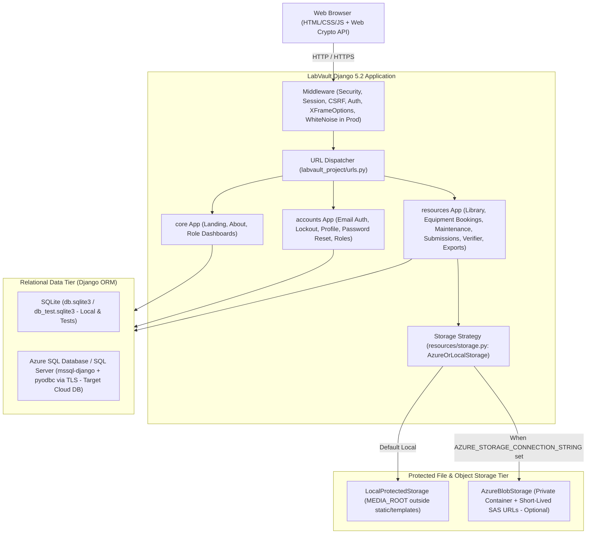
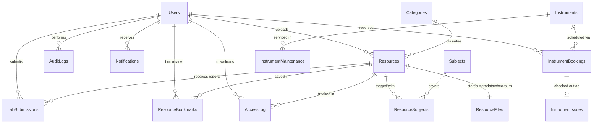

# LabVault

LabVault is an academic laboratory resource, equipment scheduling, and student report submission web application built with Django 5.2. It provides role-separated workspaces for students, faculty members, and laboratory administrators, backed by a Third Normal Form (3NF) relational schema, cryptographic file integrity verification, and configurable local or Microsoft Azure cloud backends.

> **Project status note:** The core Django application runs locally with SQLite (`DB_ENGINE=sqlite`) and local protected file storage. Full Microsoft Azure SQL Database and Azure Blob Storage integration is configured in code (`mssql-django`, `pyodbc`, `azure-storage-blob`) and remains under active environment integration.

---

## Table of Contents

- [Project Overview](#project-overview)
- [Problem Statement](#problem-statement)
- [Project Objectives](#project-objectives)
- [Main Features Implemented](#main-features-implemented)
- [User Roles and Responsibilities](#user-roles-and-responsibilities)
- [Technology Stack](#technology-stack)
- [System Architecture](#system-architecture)
- [Database Design Overview](#database-design-overview)
- [Project Folder Structure](#project-folder-structure)
- [Installation and Local Setup](#installation-and-local-setup)
- [Environment Variable Configuration](#environment-variable-configuration)
- [Render Docker Deployment](#render-docker-deployment)
- [Database Setup Instructions](#database-setup-instructions)
- [Screenshots](#screenshots)
- [Security Features Implemented](#security-features-implemented)
- [Academic Relevance](#academic-relevance)
- [Current Development Status and Future Improvements](#current-development-status-and-future-improvements)

---

## Project Overview

Academic engineering and science departments manage laboratory manuals, reference code, shared instruments, student experiment reports, and safety calibration records across disconnected tools. LabVault consolidates those workflows into a single server-rendered Django web application (`labvault_project`) organized around three modular apps:

- **`core`**: Public landing page, institutional about page, and role-aware workspace routing (`dashboard`, `faculty-dashboard`, `admin-dashboard`).
- **`accounts`**: Email-based custom user authentication, role definitions, registration, profile settings, personal access logs, password recovery, failed-login throttling, and optional OAuth provider wiring.
- **`resources`**: Laboratory manual repository, subject/category directory, protected file storage abstraction, SHA-256 verification utility, equipment inventory, interval-checked bookings, issue/return tracking, maintenance logs, student report submissions, faculty grading, ReportLab PDF manual generation, notifications, bookmarks, and CSV/JSON operational exports.

In addition to the active Django application, the repository includes legacy Flask code (`app/`, `run.py`) still exercised by unit tests, reference T-SQL schema scripts (`database/`), and technical engineering documentation (`docs/`).

---

## Problem Statement

Traditional university laboratory coordination suffers from several recurring operational and integrity gaps:

1. **Fragmented study materials**: Lab manuals, circuit sheets, and starter code are scattered across chat groups and shared folders without consistent subject indexing, version/checksum records, or access control.
2. **Unverified file integrity**: Downloaded experiment manuals and submitted student reports rarely carry cryptographic checksums to verify that files were not altered or corrupted after publication.
3. **Equipment scheduling conflicts**: Shared instruments (such as oscilloscopes, spectrum analyzers, or test benches) lack structured overlap prevention, formal checkout/due-date tracking, and accessible calibration histories.
4. **Disconnected report evaluation**: Collecting practical reports over email or generic forms makes it difficult to pair submissions with course manuals, track resubmissions, notify students, and maintain audit trails.
5. **Weak accountability for academic accreditation**: Laboratory coordinators often lack structured access logs, maintenance records, and exportable compliance reports required for engineering program reviews.

---

## Project Objectives

LabVault was designed to satisfy the following functional, relational, and security objectives:

1. **Centralize academic lab resources** with category and subject tagging, visibility controls (`public` / `private`), bookmarking, and server-side access enforcement.
2. **Guarantee booking conflict safety** for laboratory equipment through database-level interval overlap detection, atomic transactions, and explicit checkout/return workflows.
3. **Digitize practical report evaluation** by linking student submissions directly to lab resources, computing SHA-256 digests on upload, and supporting scored reviews (`0` to `100`), feedback, and resubmission requests.
4. **Enforce defense-in-depth application controls** using Argon2id password hashing, brute-force lockouts, MIME magic-byte validation, unpredictable storage keys, and strict role checks.
5. **Model a normalized 3NF database** portable between SQLite for local academic demonstrations and Microsoft SQL Server / Azure SQL Database via `mssql-django` and `pyodbc`.
6. **Decouple structured metadata from unstructured file objects** cleanly so files can live in local protected storage (`MEDIA_ROOT`) during development or private Azure Blob Storage containers in cloud deployments.

---

## Main Features Implemented

### 1. Resource Catalog & Protected Document Handling
- Search, filter by category or subject code, sort (`created_at`, `title`, `file_size`, `updated_at`), and paginate laboratory resources (`/resources/library/`).
- Department and subject directory with live resource counts (`/resources/departments/`).
- Upload resources (`/resources/upload/`) with subject assignments, category classification, `public` or `private` visibility, extension allowlisting, magic-byte MIME detection, and 10 MB default upload limits (`MAX_CONTENT_LENGTH`).
- Automatic cleanup if database metadata persistence fails after saving a file.
- Authenticated downloads (`/resources/resource/<pk>/download/`) with `AccessLog` entry recording (user, resource, timestamp, client IP) and `Content-Disposition: attachment`.
- Edit, delete, and bookmark toggle (`/resources/resource/<pk>/bookmark/`) support gated by ownership and role permissions.

### 2. Laboratory Equipment Inventory, Bookings & Issue Lifecycle
- Active equipment catalog (`/resources/instruments/`) searchable by keyword, department, and operational status (`available`, `in_use`, `maintenance`, `retired`).
- Instrument reservation requests (`/resources/instruments/<pk>/book/`) with validation enforcing end time after start time and interval overlap prevention against active approved/issued bookings (`start_time < existing.end_time AND end_time > existing.start_time`).
- Cancellation of pending bookings by the requesting student, and approval/rejection by administrators using row-level locking (`select_for_update`) inside `transaction.atomic()`.
- Physical checkout and return workflow (`/resources/instrument-bookings/<pk>/issue/` and `/resources/instrument-issues/<pk>/return/`) recording due timestamps, overdue status checks, issuer/receiver identity, and return condition notes.

### 3. Calibration & Maintenance History
- Dedicated maintenance log per instrument (`/resources/instruments/<pk>/maintenance/`) recording technician identity, service type (`calibration`, `routine_service`, `repair`, `safety_inspection`), inspection outcome, and next due dates.

### 4. Practical Submissions & Faculty Evaluation
- Students submit laboratory report files (`/resources/resource/<pk>/submit/`, up to 25 MB) with optional notes and server-computed SHA-256 digests.
- Role-scoped submission hub (`/resources/submissions/`):
  - **Students** view their own submissions, status (`Submitted`, `Reviewed & Verified`, `Resubmission Required`), grades, and instructor feedback.
  - **Faculty** inspect and evaluate submissions linked to resources they own (`grade_submission`, numeric grade `0.0` to `100.0`, feedback notes, and status updates).
  - **Administrators** maintain platform-wide submission oversight.
- Automated in-app `Notification` creation and `AuditLog` entries on upload, booking decisions, equipment issue/return, submission, and grading events.

### 5. Cryptographic SHA-256 Document Verifier & PDF Lab Manuals
- **Browser-local verifier** (`/resources/verify/`): Uses the browser Web Crypto API (`crypto.subtle.digest`) to compute SHA-256 hashes client-side without transmitting file bytes over the network, allowing verification against institutional SHA-256 records stored in `ResourceFiles`.
- **Flowing PDF manual layout** (`resources/manual_pdf.py`): ReportLab Platypus generator formatting academic department headers, wrapped sections, equations, and multi-page observation tables with repeated headers.

### 6. Exports & Activity Logs
- Personal download history page for signed-in users (`/accounts/security-log/`).
- Administrator-only compliance exports:
  - Access/audit log export in **CSV** or **JSON** (`/resources/export/audit-log/`).
  - Equipment inventory and utilization summary in **CSV** (`/resources/export/equipment-report/`).

---

## User Roles and Responsibilities

LabVault enforces role-based access control server-side in views (`core/views.py`, `resources/views.py`, `accounts/views.py`). Attempting to open another role's workspace returns HTTP `403` with a role-mismatch explanation page (`templates/errors/403.html`).

| Role | Workspace Route | How Assigned | Verified Capabilities |
|---|---|---|---|
| **Unauthenticated Visitor** | `/` (Landing) | Default anonymous visitor | View landing page, `/about/`, `/resources/departments/`, `/resources/instruments/` catalog, `/resources/verify/` client-side hasher, register new Student accounts (`/accounts/register/`), sign in (`/accounts/login/`), or request password reset (`/accounts/password-reset/`). |
| **Student** (`student`) | `/dashboard/` | Assigned automatically upon public registration | Browse authorized resources, upload/edit/delete own resources, bookmark resources, request equipment bookings, cancel own pending bookings, submit lab reports, track grades/feedback, manage notifications, view personal security download log, and update password/profile. |
| **Faculty** (`faculty`) | `/faculty-dashboard/` | Assigned by an Administrator via Django Admin | Includes student resource browsing/upload/profile capabilities, plus a dedicated review queue (`/resources/submissions/`) to download and grade (`0-100`) or request resubmission for student reports submitted against resources owned by that faculty member. |
| **Administrator** (`administrator`) | `/admin-dashboard/` & `/admin/` | Created via `python manage.py createsuperuser` or promoted in Django Admin | Platform-wide oversight across users and resources; approve/reject equipment bookings; issue and record returns for instruments; log calibration/maintenance records; inspect/evaluate all submissions; manage user roles/accounts in Django Admin; and export audit logs (CSV/JSON) and equipment reports (CSV). |

---

## Technology Stack

The active application is built with the following verified components (see `requirements.txt` and `labvault_project/settings.py`):

| Layer | Technology / Package | Version / Notes | Purpose in LabVault |
|---|---|---|---|
| **Language & Runtime** | Python | `3.11+` | Core server runtime |
| **Web Framework** | Django | `5.2.18` | Routing, ORM, auth, CSRF, templates, admin |
| **WSGI & Static Serving** | Gunicorn / WhiteNoise | `23.0.0` / `6.12.0` | Production WSGI server & compressed static assets |
| **Relational DB Driver** | `mssql-django` + `pyodbc` | `2.0.0` + `5.3.0` | SQL Server / Azure SQL backend via ODBC Driver 18/17 |
| **Local / Test Database** | SQLite (`sqlite3`) | Python built-in | Local development (`DB_ENGINE=sqlite`) and automated tests |
| **Object Storage SDK** | `azure-storage-blob` | `12.31.0` | Optional Azure Blob Storage + read-only SAS URLs |
| **Password Hashing** | `argon2-cffi` | `23.1.0` | Argon2id primary password hasher (with PBKDF2 fallback) |
| **OAuth (Optional)** | `social-auth-app-django`, `requests-oauthlib` | `7.2.0`, `2.0.0` | Google, Microsoft, GitHub OAuth2 pipelines when configured |
| **PDF Engine** | `reportlab` | `5.1.0` | Flowing multi-page laboratory manual PDF generation |
| **Env Configuration** | `python-dotenv` | `1.0.1` | Loads `.env` (or `LABVAULT_ENV_FILE`) in local setups |
| **Frontend UI** | Django Templates, CSS Tokens, Vanilla JS, GSAP | `templates/`, `static/` | Server-rendered accessible UI, Web Crypto verifier, subtle animations |
| **Testing** | `pytest`, `pytest-django` | `8.3.3`, `4.8.0` | Automated unit, workflow, security, and route suite |

> **Retained legacy package:** `requirements.txt` also lists `Flask==3.1.2` and `Flask-WTF==1.2.1` solely because repository unit tests (`tests/test_auth.py`, `tests/test_repositories.py`, `tests/test_security.py`, `tests/test_storage.py`, `tests/test_validation.py`) import validation and service modules from `app/`.

---

## System Architecture

LabVault follows a modular monolithic Django architecture with a strict boundary between HTTP request handling, relational persistence, and file/object storage:



---

## Database Design Overview

LabVault uses a Third Normal Form (3NF) relational schema managed by Django migrations (`accounts/migrations/` `0001`-`0004` and `resources/migrations/` `0001`-`0008`). Reference T-SQL baseline scripts (`database/schema.sql`, `database/indexes.sql`, `database/seed.sql`) are also included for standalone SQL Server setup.

### Entity Summary (16 Relational Tables)

| Table (`db_table`) | Django Model | Key Responsibility & Constraints |
|---|---|---|
| `Users` | `accounts.User` | Custom `AbstractUser` authenticated by unique normalized `email`; stores `role` (`student`, `faculty`, `administrator`) and Argon2/PBKDF2 password hash |
| `LoginAttempts` | `accounts.LoginAttempt` | Tracks failed attempts per `(email, ip_address)` unique pair with `locked_until` timestamp and index `IX_LoginAttempts_LockedUntil` |
| `Categories` | `resources.Category` | Unique resource classification categories |
| `Subjects` | `resources.Subject` | Unique academic subject codes (`subject_code`) and names |
| `Resources` | `resources.Resource` | Resource metadata, `category` FK (`SET NULL`), `uploaded_by` FK (`CASCADE`), visibility (`public`/`private`), `file_size_bytes`, indexes (`IX_Resources_*`) |
| `ResourceSubjects` | `resources.ResourceSubject` | Many-to-many junction table resolving `Resources` <-> `Subjects` with composite unique constraint `unique_resource_subject` |
| `ResourceFiles` | `resources.ResourceFiles` | 1:1 file integrity table (`resource` PK/FK `CASCADE`) storing unique `storage_key`, `original_filename`, MIME `content_type`, and 64-char `sha256_checksum` |
| `AccessLog` | `resources.AccessLog` | Non-repudiation download ledger recording `user`, `resource`, `accessed_at`, and `ip_address` |
| `AuditLogs` | `resources.AuditLog` | Administrative and security event trail (`actor`, `action`, `entity_type`, `entity_id`, `created_at`) |
| `Notifications` | `resources.Notification` | In-app notifications keyed by `recipient` and `is_read` |
| `Instruments` | `resources.Instrument` | Laboratory hardware catalog with unique `asset_id`, `department`, `location`, `status`, `is_active`, and `last_calibrated` |
| `InstrumentBookings` | `resources.InstrumentBooking` | Equipment reservations with `CheckConstraint` (`end_time > start_time`), status workflow, and range index `IX_InstBook_Range` |
| `InstrumentIssues` | `resources.InstrumentIssue` | 1:1 physical issue/return tracking linked via `PROTECT` FK to an approved `InstrumentBooking`, with `due_at`, `returned_at`, `return_condition` |
| `LabSubmissions` | `resources.LabSubmission` | Student lab report uploads per `Resource` storing unique `storage_key`, `sha256_checksum`, `status`, `grade` (`Decimal(4,1)`), `faculty_feedback`, and `reviewed_by` |
| `InstrumentMaintenance` | `resources.InstrumentMaintenance` | Calibration, routine service, repair, and safety inspection history per `Instrument` |
| `ResourceBookmarks` | `resources.ResourceBookmark` | Saved resources per user with composite unique constraint `unique_user_resource_bookmark` |

### Core Entity-Relationship Diagram



---

## Project Folder Structure

```text
labvault/
├── accounts/                     # Custom email User model, LoginAttempt lockout, auth views, OAuth pipeline
│   └── migrations/               # Account schema migrations (0001 to 0004)
├── core/                         # Landing page, About page, role-separated dashboards (Student/Faculty/Admin)
├── resources/                    # Catalog, upload/download, SHA-256 verifier, equipment, bookings, submissions, PDFs
│   ├── migrations/               # Resource, booking, issue, submission, maintenance migrations (0001 to 0008)
│   ├── manual_pdf.py             # Flowing ReportLab Platypus lab manual PDF generator
│   └── storage.py                # Validation, SHA-256 hashing, LocalProtectedStorage & AzureBlobStorage
├── labvault_project/             # Django project settings, settings_test.py, root URLs, WSGI/ASGI, error handlers
├── templates/                    # Server-rendered HTML templates (auth, dashboards, resources, profile, errors, includes)
├── static/                       # CSS design tokens, dashboard styles, components, vanilla JS, GSAP vendor assets
├── tests/                        # Automated pytest suite (auth, RBAC, storage, instruments, submissions, security)
├── database/                     # Reference T-SQL scripts (schema.sql, indexes.sql, seed.sql)
├── docs/                         # SRS, architecture, database design, DP-900 mapping, security & test docs
├── app/                          # Legacy Flask modules (imported by repository unit tests)
├── .env.example                  # Safe placeholder-only environment template (copy to ignored .env)
├── .gitignore                    # Excludes .env*, local SQLite DBs, media/, .venv/, Framer/, caches, logs
├── manage.py                     # Django CLI management entrypoint
├── pytest.ini                    # Configures pytest against labvault_project.settings_test
├── requirements.txt              # Pinned Python dependencies
├── run.bat / run.ps1             # Windows local development server launchers
├── run.py                        # Compatibility entrypoint
└── startup.sh                    # Container WSGI + ODBC Driver 18 startup script (for Linux/App Service targets)
```

> Local directories created at runtime or kept strictly outside version control - such as `.env`, `.venv/`, `db.sqlite3`, `db_test.sqlite3`, `media/`, `storage/`, `staticfiles/`, `scratch/`, and `Framer/` - are excluded by `.gitignore`.

---

## Installation and Local Setup

### Prerequisites

- **Python 3.11+** (verified locally on Windows; compatible with Linux/macOS)
- **Git**
- *(Optional for SQL Server / Azure SQL only)* **Microsoft ODBC Driver 18 for SQL Server** (or Driver 17) and network access to a SQL Server instance

### Step-by-Step Local Setup (Windows PowerShell)

1. **Clone the repository**

```powershell
git clone https://github.com/Savinay99/LABVAULT.git
cd LABVAULT
```

2. **Create and activate a virtual environment**

```powershell
python -m venv .venv
.\.venv\Scripts\Activate.ps1
python -m pip install --upgrade pip
pip install -r requirements.txt
```

*(On Linux/macOS, activate with `source .venv/bin/activate`.)*

3. **Create your private `.env` file from the template**

```powershell
Copy-Item .env.example .env
```

4. **Generate a unique local `DJANGO_SECRET_KEY`**

```powershell
python -c "from django.core.management.utils import get_random_secret_key; print(get_random_secret_key())"
```

Paste the generated key into `DJANGO_SECRET_KEY` inside your local `.env` file. Never commit `.env`.

5. **Apply database migrations and create an administrator account**

```powershell
python manage.py migrate
python manage.py createsuperuser
```

The `createsuperuser` prompt assigns the LabVault `administrator` role to the created account. Student accounts can be created via `/accounts/register/`, and `faculty` roles can be assigned from `/admin/`.

6. **Run the development server**

```powershell
python manage.py runserver 127.0.0.1:8000
```

Alternatively, on Windows you can use the launcher scripts (`./run.ps1` or `run.bat`), which activate `.venv\Scripts\python.exe`, default `DJANGO_DEBUG=True` if unset, and start the development server at `http://127.0.0.1:8000`.

7. **Run the automated verification suite**

```powershell
python manage.py check --settings=labvault_project.settings_test
python manage.py makemigrations --check --dry-run --settings=labvault_project.settings_test
python -m pytest -q
```

---

## Environment Variable Configuration

All sensitive settings and runtime switches are injected via environment variables or the gitignored `.env` file (see `.env.example`). Placeholder values must be replaced locally before use.

| Variable | Placeholder / Default | Purpose |
|---|---|---|
| `DJANGO_SETTINGS_MODULE` | `labvault_project.settings` | Active Django settings module |
| `DJANGO_SECRET_KEY` | `<generated-random-secret-key>` | Required whenever `DJANGO_DEBUG=False` (startup fails on placeholder keys in production) |
| `DJANGO_DEBUG` | `True` (local) / `False` (prod) | Toggles debug mode and enforces strict cookie/TLS checks when `False` |
| `ALLOWED_HOSTS` | `localhost,127.0.0.1` | Comma-separated allowed hostnames |
| `LABVAULT_ENV_FILE` | `.env` | Optional override path for selecting an alternate ignored env file locally |
| `DB_ENGINE` | `sqlite` (local) / `mssql` (SQL Server) | Selects Django SQLite backend or `mssql-django` SQL Server backend |
| `DB_AUTH_MODE` | `password` or `managed_identity` | Uses SQL login credentials or Azure Managed Identity (`ActiveDirectoryMsi`) |
| `DB_HOST` | `localhost` or `<your-sql-server>.database.windows.net` | Database server hostname (also accepts `SQL_SERVER` fallback) |
| `DB_PORT` | `1433` | Database TCP port |
| `DB_NAME` | `LabVault` or `<your-azure-sql-database>` | Target database name (also accepts `SQL_DB` fallback) |
| `DB_USER` | `<your-sql-username>` | SQL Server login username when `DB_AUTH_MODE=password` (`SQL_USER` fallback) |
| `DB_PASSWORD` | `<your-sql-password>` | SQL Server password (`SQL_PASSWORD` fallback) |
| `DB_DRIVER` | `ODBC Driver 18 for SQL Server` | Installed Microsoft ODBC driver name |
| `DB_TRUSTED_CONNECTION` | `False` | Enables Windows Integrated Auth when `True` on local SQL Server |
| `DB_ENCRYPT` | `True` | Enforces TLS encryption (`Encrypt=yes`) over ODBC |
| `DB_TRUST_SERVER_CERTIFICATE` | `False` | Keep `False` in production so server TLS certificates are verified |
| `MEDIA_ROOT` | `./media` | Local directory for `LocalProtectedStorage` (kept outside public static files) |
| `MAX_CONTENT_LENGTH` | `10485760` | Default maximum resource upload size in bytes (`10 MB`) |
| `SESSION_COOKIE_SECURE` | `False` (dev) / `True` (prod) | Requires HTTPS for session cookies when `True` |
| `CSRF_COOKIE_SECURE` | `False` (dev) / `True` (prod) | Requires HTTPS for CSRF cookies when `True` |
| `SESSION_COOKIE_SAMESITE` | `Lax` | SameSite cookie policy |
| `PERMANENT_SESSION_LIFETIME` | `1800` | Session timeout in seconds (30 minutes default) |
| `CSRF_TRUSTED_ORIGINS` | `<https://your-domain.example>` | Comma-separated trusted HTTPS origins for production CSRF checks |
| `LOGIN_MAX_FAILED_ATTEMPTS` | `5` | Failed attempts per email/IP before temporary lockout |
| `LOGIN_LOCKOUT_SECONDS` | `900` | Lockout duration in seconds (15 minutes default) |
| `AZURE_STORAGE_CONNECTION_STRING` | *(unset locally)* | Optional Azure Blob Storage connection string; local storage is used when omitted |
| `AZURE_STORAGE_CONTAINER_NAME` | `labvault` | Target private Azure Blob container name |
| `EMAIL_BACKEND` | `django.core.mail.backends.console.EmailBackend` | Console backend in dev; configure SMTP backend for production password resets |
| `EMAIL_HOST`, `EMAIL_PORT`, `EMAIL_USE_TLS` | `smtp.gmail.com`, `587`, `True` | SMTP relay settings |
| `EMAIL_HOST_USER`, `EMAIL_HOST_PASSWORD` | `<your-smtp-user>`, `<your-smtp-password>` | SMTP credentials (never commit real values) |
| `DEFAULT_FROM_EMAIL` | `LabVault <no-reply@labvault.local>` | Sender header for password reset messages |
| `SOCIAL_AUTH_*` | *(optional / empty)* | Google, Microsoft, and GitHub OAuth2 client keys and secrets |

---

## Render Docker Deployment

LabVault includes a Docker image for Render with Python 3.12, Microsoft's Debian 12 package repository, unixODBC, and Microsoft ODBC Driver 18. `pyodbc` and Gunicorn are installed from `requirements.txt`. The container runs as an unprivileged user. It collects static files when the container starts, then runs the existing Django WSGI application with Gunicorn. It does not run database migrations.

In Render, create a Web Service from this repository and select the Docker runtime. Set the root directory to the repository root and the Dockerfile path to `./Dockerfile`. Leave the Docker Command override empty so Render uses the command from the Dockerfile.

Set these environment variables in the Render service settings:

| Variable | Value |
|---|---|
| `DJANGO_SETTINGS_MODULE` | `labvault_project.settings` |
| `DJANGO_DEBUG` | `False` |
| `DJANGO_SECRET_KEY` | Generate a strong private value in Render. Do not put it in the repository or Dockerfile. |
| `ALLOWED_HOSTS` | The service hostname, for example `labvault.onrender.com` |
| `CSRF_TRUSTED_ORIGINS` | The HTTPS origin, for example `https://labvault.onrender.com` |
| `SESSION_COOKIE_SECURE` | `True` |
| `CSRF_COOKIE_SECURE` | `True` |
| `PORT` | Leave unset so Render supplies it. The container defaults to `10000` for local runs. |

Render sets `RENDER=true` automatically. Django uses Render's forwarded HTTPS protocol header when this value is present, so the production HTTPS redirect can distinguish proxy HTTPS requests from the internal HTTP connection.

Configure the existing database through these Django environment variables in Render:

| Variable | Value |
|---|---|
| `DB_ENGINE` | `mssql` |
| `DB_AUTH_MODE` | `password` for a SQL login |
| `DB_HOST` | Existing SQL server hostname |
| `DB_PORT` | `1433` |
| `DB_NAME` | Existing database name |
| `DB_USER` | Existing SQL login name |
| `DB_PASSWORD` | Existing SQL password, stored as a Render secret |
| `DB_DRIVER` | `ODBC Driver 18 for SQL Server` |
| `DB_TRUSTED_CONNECTION` | `False` |
| `DB_ENCRYPT` | `True` |
| `DB_TRUST_SERVER_CERTIFICATE` | `False` |

Do not place database credentials in the image, Dockerfile, or README.

Static assets use Django's production WhiteNoise storage and are collected by `startup.sh`. Uploaded files use local storage unless Azure Blob Storage or another persistent storage configuration is supplied. A container filesystem is not persistent across replacements, so configure durable storage before accepting uploads in production.

Build locally with `docker build -t labvault .` and run with the required Django and database environment variables supplied at runtime. Do not pass production secrets as Docker build arguments. Database migrations are a separate controlled operation and are not run by the image.

---

## Database Setup Instructions

### Option A: Local SQLite Setup (Default for Development & Review)

1. Ensure `.env` sets `DB_ENGINE=sqlite` and `DJANGO_DEBUG=True`.
2. Run Django migrations:

```powershell
python manage.py migrate
```

This initializes `db.sqlite3` (ignored by Git) with all `accounts`, `resources`, `sessions`, and `admin` tables.

### Option B: Isolated Automated Test Database

`pytest.ini` automatically targets `labvault_project.settings_test`, which uses an isolated SQLite database (`db_test.sqlite3`) and fast test hashers so automated test runs never modify `db.sqlite3` or any remote SQL Server instance:

```powershell
python -m pytest -q
```

### Option C: Microsoft SQL Server / Azure SQL Database Target

Live Azure SQL integration is still in progress on the target environment, and the codebase already includes the `mssql-django` + `pyodbc` configuration required when connecting:

1. Ensure Microsoft ODBC Driver 18 for SQL Server (or Driver 17, matching `DB_DRIVER`) is installed on your machine.
2. In your local ignored `.env`, configure `DB_ENGINE=mssql`, `DB_HOST`, `DB_PORT`, `DB_NAME`, `DB_USER`, `DB_PASSWORD`, `DB_ENCRYPT=True`, and `DB_TRUST_SERVER_CERTIFICATE=False`.
3. Apply Django schema migrations to initialize all 16 application tables:

```powershell
python manage.py migrate
```

> **Note:** The `database/` folder also preserves `schema.sql`, `indexes.sql`, and `seed.sql` as T-SQL 3NF reference scripts from the initial repository design (covering core tables and optional sample Categories/Subjects). For the active Django 5.2 application, `python manage.py migrate` is the authoritative schema mechanism.

---

## Screenshots

Static UI screenshots are not yet bundled in the repository (`static/` or `docs/`). Once final captures are taken from a live demonstration environment, place images under `docs/screenshots/` and link them below:

| View / Workflow | Target Route | Status | Preview Placeholder |
|---|---|---|---|
| Public Landing & Overview | `/` | Verified in local browser QA | `` *(Placeholder - add capture after final environment freeze)* |
| Student Learning Desk | `/dashboard/` | Verified in local browser QA | `` *(Placeholder)* |
| Faculty Teaching Workbench | `/faculty-dashboard/` | Verified in local browser QA | `` *(Placeholder)* |
| Admin Operations Console | `/admin-dashboard/` | Verified in local browser QA | `` *(Placeholder)* |
| Equipment Inventory & Bookings | `/resources/instruments/` | Verified in local browser QA | `` *(Placeholder)* |
| Cryptographic Document Verifier | `/resources/verify/` | Implemented with `crypto.subtle` | `` *(Placeholder)* |

---

## Security Features Implemented

Every control listed below is verified directly in `labvault_project/settings.py`, `accounts/views.py`, `accounts/models.py`, `resources/storage.py`, `resources/views.py`, and `templates/resources/verify.html`:

- **Credential Hardening (`accounts`, `settings.py`)**: Uses `Argon2PasswordHasher` as the primary password hasher (with PBKDF2 fallbacks) and enforces Django's four built-in password validators (`UserAttributeSimilarityValidator`, `MinimumLengthValidator(8)`, `CommonPasswordValidator`, `NumericPasswordValidator`).
- **Brute-Force Protection (`LoginAttempt`)**: Tracks failed login counts per normalized email and IP address (`accounts/views.py`) and enforces temporary lockouts after `LOGIN_MAX_FAILED_ATTEMPTS` (default `5`) for `LOGIN_LOCKOUT_SECONDS` (default `900s`), while displaying generic login error messages to prevent user enumeration.
- **Session, CSRF & Cookie Security (`settings.py`)**: Enables `SESSION_COOKIE_HTTPONLY=True`, `CSRF_COOKIE_HTTPONLY=True`, `SameSite=Lax`, configurable session lifetime (`1800s`), and rejects startup if `DJANGO_DEBUG=False` without a non-placeholder `DJANGO_SECRET_KEY` and secure HTTPS cookies (`SESSION_COOKIE_SECURE` and `CSRF_COOKIE_SECURE`).
- **HTTP Hardening Headers**: Sets `X_FRAME_OPTIONS = "DENY"`, `SECURE_CONTENT_TYPE_NOSNIFF = True`, `SECURE_REFERRER_POLICY = "strict-origin-when-cross-origin"`, plus HTTPS redirect and HSTS headers when debug is disabled.
- **Open-Redirect Defense**: Login and logout `next` redirects validate host and scheme via `url_has_allowed_host_and_scheme` (`_safe_next`).
- **Server-Side RBAC & Ownership Checks**: Every dashboard, submission review, instrument action, maintenance record, download, and compliance export enforces role and ownership checks server-side, returning a structured HTTP `403` role-guidance response on role mismatch (`_role_access_denied`).
- **Perimeter File Upload Validation & Key Unpredictability (`resources/storage.py`)**: Enforces extension allowlisting (`ALLOWED_EXTENSIONS`), magic-byte MIME signature inspection (`MAGIC_SIGNATURES`), size ceilings (`10 MB` default resource uploads / `25 MB` student submissions), transactional rollback on DB failure, and unpredictable server-generated storage keys (`uuid4().hex + secrets.token_hex(8) + ext`).
- **Cryptographic Integrity & Delegated Downloads**: Computes SHA-256 digests (`compute_sha256`) on upload into `ResourceFiles` and `LabSubmission`, offers browser-local `crypto.subtle` verification at `/resources/verify/`, serves local files through authorized `FileResponse(..., as_attachment=True)` views, and issues read-only Azure Blob SAS URLs with 30-minute default expiry when Blob Storage is configured.
- **Query Safety & Audit Trails**: All persistence uses parameterized Django ORM queries, whitelisted sort columns/directions in `library()`, and persistent `AccessLog` + `AuditLog` tracking.

> **Security scope transparency:** TOTP two-factor authentication, runtime Azure Key Vault secret fetching, and a Content-Security-Policy response middleware header are documented in `docs/SECURITY_AND_PRIVACY.md` as planned hardening items and are not yet active in middleware/models.

---

## Academic Relevance

LabVault was built to demonstrate core software engineering and cloud data competencies across four university review pillars:

### System Design
- Clean separation of concerns across modular Django apps (`core`, `accounts`, `resources`) and server-rendered template inheritance (`templates/`).
- Strategy/Adapter storage interface (`StorageBackend` -> `LocalProtectedStorage` / `AzureBlobStorage`) enabling seamless switching between local protected filesystem storage and cloud object storage without modifying view logic.
- Concurrency-safe booking approval and instrument issue/return state machines backed by `transaction.atomic()` and row locking (`select_for_update()`).

### RDBMS (Relational Database Management Systems)
- Strict Third Normal Form (3NF) decomposition: separating file storage/integrity metadata (`ResourceFiles`) from resource catalog metadata (`Resources`), resolving M:N tags cleanly (`ResourceSubjects`, `ResourceBookmarks`), and isolating 1:1 checkout records (`InstrumentIssues`) from reservations (`InstrumentBookings`).
- Declarative integrity through primary keys, foreign keys (`CASCADE`, `SET NULL`, `PROTECT`), unique constraints, `CheckConstraint` (`end_time > start_time`), and targeted composite B-tree indexes (`IX_*`) aligned with query patterns.

### DP-900 / Azure Data Fundamentals
- Demonstrates separation between **structured relational OLTP workloads** (`Users`, `Resources`, `InstrumentBookings`, `LabSubmissions`, `AuditLogs` designed for Azure SQL Database via `mssql-django` / `pyodbc`) and **unstructured BLOB/object workloads** (uploaded PDFs, code files, and lab reports targeting private Azure Blob Storage containers).
- Implements transactional data integrity (`transaction.atomic()`) alongside structured analytical extraction endpoints (`/resources/export/audit-log/` in CSV/JSON and `/resources/export/equipment-report/` in CSV).

### Cloud Security
- Applies STRIDE-informed application safeguards: Argon2id credential hashing, brute-force lockouts, least-privilege server-side RBAC, perimeter file signature validation, non-predictable object keys, encrypted ODBC transport (`Encrypt=yes;TrustServerCertificate=no`), delegated SAS read URLs with short TTLs, and non-repudiation audit trails.

---

## Current Development Status and Future Improvements

### Current Development Status
- **Active Django Application**: Verified functional locally with SQLite (`DB_ENGINE=sqlite`) across authentication, role-separated dashboards, resource uploads/downloads, instrument catalog and conflict-checked bookings, issue/return flows, maintenance logs, submission grading, ReportLab PDF manual generation, cryptographic hash verification, and CSV/JSON exports.
- **Automated Test Suite**: Verified locally on `labvault_project.settings_test` (`python -m pytest -q` -> **117 passed, 1 warning**, from the third-party `openid` dependency using deprecated `defusedxml.cElementTree`).
- **Azure Integration Status**: Django SQL Server settings (`mssql-django`, `pyodbc`, `DB_AUTH_MODE=managed_identity|password`) and `AzureBlobStorage` backend code are in place, while live Azure SQL Database connection rollout, App Service hosting, and Blob Storage provisioning remain in progress.
- **Legacy Compatibility Code Retained**: `app/` (legacy Flask modules still imported by unit tests in `tests/`) and `database/` reference T-SQL scripts are retained without removing working application code; dormant unintegrated prototypes and local-only directories (`Framer/`) are excluded via `.gitignore`.

### Planned Future Improvements
- **Complete Azure Cloud Rollout**: Provision Azure App Service and private Azure Blob Storage container, verify Linux ODBC Driver 18 connectivity in runtime, and finalize live Azure SQL Database workflows.
- **Managed Identity & Key Vault**: Replace environment-injected credentials with Microsoft Entra ID Managed Identity (`DB_AUTH_MODE=managed_identity`) and Azure Key Vault secret references.
- **Additional Security Hardening**: Add TOTP multi-factor authentication for privileged roles, explicit Content-Security-Policy middleware headers, automated orphan blob cleanup jobs, and production SMTP email alerts.
- **UI & Maintenance Polish**: Make the cinematic loader overlay dismissible per session, serve `/favicon.ico`, add captured UI screenshots under `docs/screenshots/`, and retire legacy `app/` compatibility tests once migrated fully to Django equivalents.
