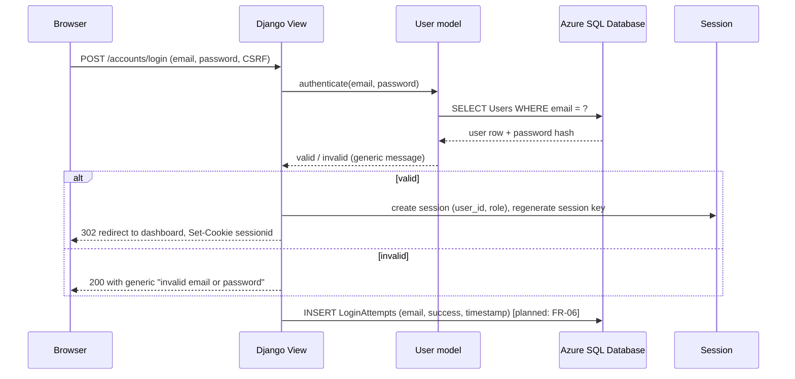
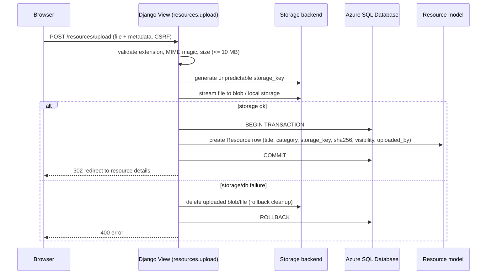
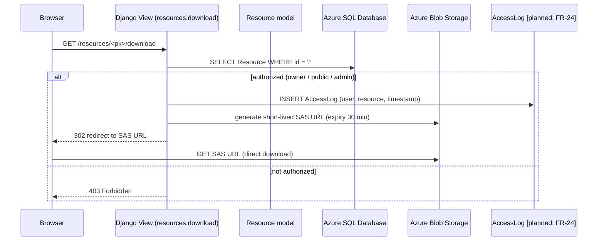
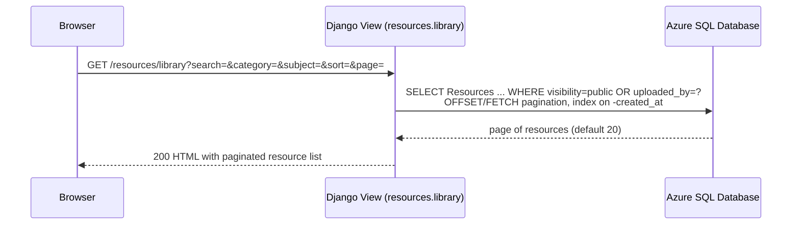

# Architecture  -  LabVault

**Document version:** 1.0
**Status:** Draft (architecture only  -  no code changes in this phase)
**Standard:** ISO/IEC/IEEE 42010 (Systems and software engineering  -  Architecture description)
**Project:** LabVault  -  secure academic laboratory resource and document management portal
**Repository:** `E:\labvault` (Django 5.2, mssql-django, Azure SQL Database, Azure Blob Storage)

---

## 1. Introduction

### 1.1 Purpose

This document describes the architecture of LabVault: system structure, component boundaries, deployment topology, request flows, and architectural decision records. It is the second document in the LabVault documentation sequence, following `SRS.md`. It captures architecture only; no code is changed in this phase.

### 1.2 Scope

In scope: Django application structure, module boundaries, database and storage integration, authentication/authorization flow, resource upload/download flow, security headers, deployment topology, and architectural decision records. Out of scope: detailed class-level design, frontend component internals, infrastructure-as-code templates, CI/CD pipeline configuration.

---

## 2. System Context Diagram (Mermaid)

```mermaid
graph TD
    subgraph UserZone [End Users]
        Student[Student]
        Admin[Administrator]
        Visitor[Unauthenticated visitor]
    end

    subgraph LabVault [LabVault Django Application]
        App[(Django Web App)]
    end

    subgraph AzureCloud [Microsoft Azure]
        SQL[(Azure SQL Database<br/>TDE enabled)]
        Blob[Azure Blob Storage<br/>Private container<br/>Encryption at rest]
        KV[Azure Key Vault<br/>Secrets management]
    end

    subgraph ClientNetwork [Client Network / Internet]
        Browser[Web Browser<br/>TLS 1.2+]
    end

    Browser <-->|HTTPS| App
    App <-->|TDS (TLS)| SQL
    App -->|HTTPS / SAS| Blob
    App -->|Managed Identity| KV
    Student -->|HTTPS| Browser
    Admin -->|HTTPS| Browser
    Visitor -->|HTTPS| Browser
```

---

## 3. Component Diagram (Mermaid)

```mermaid
graph TD
    Browser[Web Browser] <-->|HTTP/HTTPS| Django[Django Application]

    subgraph Django [Django Monolith]
        URLConf[URL Dispatcher / urls.py]
        MW[Middleware<br/>Security, CSRF, Session, Auth]

        subgraph Core [core app]
            CoreViews[Core views: landing, dashboard]
        end

        subgraph Accounts [accounts app]
            AuthViews[Auth views: login, logout, register, profile]
            UserModel[User model<br/>AbstractUser, email-based]
        end

        subgraph Resources [resources app]
            ResViews[Resource views: library, upload, details, edit, delete, download]
            ResModels[Resource models<br/>Category, Subject, Resource, ResourceSubject, AuditLog]
            Storage[Storage backend<br/>AzureOrLocalStorage]
        end
    end

    Django -->|parameterized SQL (pyodbc)| SQL[(Azure SQL Database<br/>mssql-django backend)]
    Django -->|HTTPS / SAS| Blob[(Azure Blob Storage<br/>private container)]
    Django -->|Managed Identity| KV[(Azure Key Vault)]
    Django -->|TLS| SMTP[(SMTP / email<br/>documented only, not implemented)]
```

---

## 4. Deployment Diagram (Mermaid)

```mermaid
graph TD
    subgraph Client [Client Tier]
        Browser[Web Browser]
    end

    subgraph Edge [Edge / Ingress]
        LB[Load Balancer / Ingress<br/>TLS termination, WAF]
    end

    subgraph AppTier [Application Tier - Azure VM / App Service]
        Django[Django Application<br/>Gunicorn / uWSGI workers]
        SecretCache[App config<br/>env vars + Key Vault refs]
    end

    subgraph DataTier [Data Tier - Azure]
        SQL[(Azure SQL Database<br/>TDE, geo-backup)]
        Blob[(Azure Blob Storage<br/>private container, encryption at rest)]
        KV[(Azure Key Vault<br/>secrets, certificates, keys)]
    end

    Browser <-->|HTTPS| LB
    LB <-->|HTTPS| Django
    Django -->|TDS (TLS)| SQL
    Django -->|HTTPS / SAS| Blob
    Django -->|Managed Identity| KV
```

---

## 5. Module Boundaries

| Module | Responsibility | Dependencies |
|--------|----------------|--------------|
| `labvault_project` | Project settings, URL routing, error handlers, WSGI/ASGI | Django, `dotenv` |
| `core` | Landing page, dashboard, theme context | Django templates |
| `accounts` | Custom `User` model (AbstractUser, email `USERNAME_FIELD`, role), registration, login, logout, password change, profile, settings | Django auth |
| `resources` | `Category`, `Subject`, `Resource`, `ResourceSubject`, `AuditLog` models; library/upload/details/edit/delete/download views; `storage.py` backend abstraction | Django ORM, `azure-storage-blob` (optional) |
| `resources.storage` | Storage backend interface, local protected storage, Azure Blob storage, file validation (extension, MIME magic, size), storage-key generation, SAS URL generation | `azure-storage-blob` |

**Boundary rules:**
- Views call service logic directly (no separate service layer yet); business rules live in views/models.
- Storage access goes exclusively through `resources.storage.get_storage_backend()`; views never touch blob SDK directly.
- All database access goes through Django ORM (`mssql-django` backend); no raw SQL outside migrations.
- Admin actions are gated by `user.is_administrator` and, per FR-11, TOTP 2FA (planned).
- Templates render server-side HTML; vanilla JS only for theme toggle and progressive enhancement.

---

## 6. Request-Flow Diagrams (Mermaid)

### 6.1 Authentication flow



### 6.2 Upload flow



### 6.3 Download flow (Azure Blob)



### 6.4 Library flow



---

## 7. Data Flow Summary

| Flow | Data crossing boundary | Protection |
|------|----------------------|------------|
| Browser → Django | Form data, cookies, CSRF token | TLS, CSRF middleware, HttpOnly/SameSite cookies |
| Django → Azure SQL | Parameterized queries (pyodbc/mssql-django) | TLS (TDS), no string concatenation |
| Django → Azure Blob | File upload/download via SAS | Container private, short-lived SAS (≤ 30 min), managed identity |
| Django → Key Vault | Secret retrieval | Managed Identity, HTTPS |

---

## 8. Security Boundaries & Trust Zones

| Boundary | Description | Controls |
|----------|-------------|----------|
| Browser ↔ Django | Client to application over public internet | TLS 1.2+, CSP, CSRF tokens, security headers |
| Django ↔ Azure SQL | Application to database | Parameterized queries, TLS-encrypted TDS, DB credentials via env/Key Vault |
| Django ↔ Azure Blob | Application to private storage | Private container, SAS URLs, server-generated unpredictable keys |
| Admin boundary | Admin routes vs student routes | `is_administrator` check, TOTP 2FA enforced (planned FR-11) |
| Secrets boundary | Secret material in code/config | No secrets committed; Key Vault + managed identity (planned) |

---

## 9. Architectural Decision Records

### ADR-01: Django modular monolith (vs microservices)
**Decision:** Single Django project with `core`, `accounts`, `resources` apps; extractable later.
**Rationale:** Simplicity for a small academic portal; clear module boundaries allow future extraction; matches SRS technology constraint (Django 5.2).
**Status:** Implemented (current codebase).

### ADR-02: Azure SQL Database via mssql-django + pyodbc
**Decision:** SQL Server is the default and only production engine; SQLite only for tests.
**Rationale:** Project decision; avoids dual-database drift; `mssql-django` is the official Django backend for SQL Server.
**Status:** Implemented in `settings.py`.

### ADR-03: Azure Blob Storage private container with local fallback
**Decision:** `AzureOrLocalStorage` backend; Azure when connection string present, local protected storage otherwise.
**Rationale:** Development works without Azure credentials; production uses private container + SAS.
**Status:** Implemented in `resources/storage.py`.

### ADR-04: Server-generated unpredictable storage keys
**Decision:** `storage_key = uuid4().hex + secrets.token_hex(8) + ext`; original filename never used as path.
**Rationale:** Prevents path traversal, enumeration, and predictable-object attacks.
**Status:** Implemented (`generate_storage_key`).

### ADR-05: File validation at upload
**Decision:** Extension allowlist + MIME magic-byte signature + size limit (default 10 MB).
**Rationale:** Defense-in-depth against malicious uploads; magic bytes defeat extension spoofing.
**Status:** Implemented (`validate_file`, `detect_mime`).

### ADR-06: Transactional upload with blob cleanup on failure
**Decision:** Stream to storage first, then insert metadata in a transaction; on DB failure, delete the uploaded blob/file.
**Rationale:** Prevents orphaned blobs and metadata/file inconsistency.
**Status:** Required by FR-16; not yet verified in current code.

### ADR-07: Short-lived SAS for Azure downloads
**Decision:** 30-minute default SAS expiry; client redirected directly to blob.
**Rationale:** Private container; time-bound access avoids long-lived credentials.
**Status:** Implemented (`download_url`, default 30 min).

### ADR-08: Argon2 password hashing (planned migration)
**Decision:** Migrate from Django default pbkdf2 to Argon2.
**Rationale:** Project decision (SRS FR-04, NFR-03).
**Status:** Planned  -  not yet in code (current `User` inherits pbkdf2 via `AbstractUser`).

### ADR-09: django-axes for login lockout (planned)
**Decision:** Use django-axes `LoginAttempts` table for threshold-based lockout.
**Rationale:** Project decision; brute-force resistance (SRS FR-06, NFR-04).
**Status:** Planned  -  `LoginAttempts` table not in current models.

### ADR-10: TOTP 2FA for administrators (planned)
**Decision:** Administrators must enroll and present TOTP before admin actions.
**Rationale:** Elevated-role protection (SRS FR-11).
**Status:** Planned  -  not in current models.

### ADR-11: No AI features or AI wording
**Decision:** Explicitly exclude AI/ML; no AI-related user-facing text.
**Rationale:** User mandate; data-ethics and scope control.
**Status:** Constraint recorded in SRS.

### ADR-12: No third-party trackers
**Decision:** Zero third-party analytics/advertising scripts in templates.
**Rationale:** Data ethics and privacy (SRS FR-37, NFR-15).
**Status:** Constraint; templates to be audited.

### ADR-13: Server-rendered Django templates + vanilla JS
**Decision:** No frontend framework; Django templates render HTML; vanilla JS for theme toggle only.
**Rationale:** Simplicity, CSP-friendly (same-origin scripts), no build pipeline.
**Status:** Implemented (current templates).

---

## 10. Cross-References

- `SRS.md`  -  requirements (FR-##, NFR-##) that this architecture satisfies.
- `DATABASE.md`  -  table definitions, indexes, and migration approach for the models referenced here.
- `SECURITY_AND_PRIVACY.md`  -  STRIDE threat model and controls that refine the security boundaries above.

---

*End of ARCHITECTURE.md  -  Stage 2 complete. Awaiting "continue" before proceeding to Stage 3 (DATABASE.md).*
