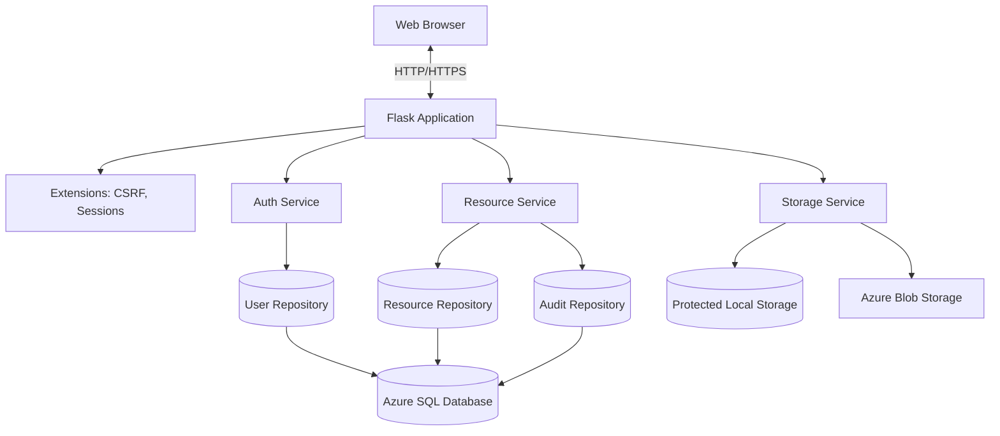

# Architecture — LabVault

## Component Diagram (Mermaid)



## Request/Response Flow

1. Client sends an HTTP request to a route.
2. Flask resolves the route via blueprints (`auth`, `dashboard`, `resources`, `profile`, `admin`).
3. Route handlers call service-layer functions (`auth_service`, `resource_service`).
4. Services enforce validation and authorization, then call repositories.
5. Repositories execute parameterized SQL against Azure SQL Database via `pyodbc`.
6. Connections are opened per operation and always closed; `db_transaction` manages commit/rollback.
7. Responses are rendered as HTML templates or JSON; security headers applied globally.

## Authentication Flow

1. User submits registration/login form (POST with CSRF token).
2. Server validates input, normalizes email, checks constraints.
3. On registration: password hashed with Werkzeug; unique email enforced by DB constraint.
4. On login: password hash verified via `check_password_hash`; generic failure messages.
5. Successful login stores user id/email/role/name in server-managed session; session regenerated.
6. Logout clears the session.

## Upload/Download Flow

1. Upload: file validated (extension, size, MIME signature); unpredictable storage key generated; file written to protected storage; metadata inserted in a transaction.
2. Download: authorization checked (owner, admin, or public); file streamed with `Content-Disposition: attachment` and `X-Content-Type-Options: nosniff`.
3. Azure: short-lived SAS URL issued for private container access.

## Database ER Diagram (Mermaid)

```mermaid
erDiagram
    Users ||--o{ Resources : "uploads"
    Categories ||--o{ Resources : "classifies"
    Subjects ||--o{ ResourceSubjects : "covers"
    Resources ||--o{ ResourceSubjects : "tagged"
    Users ||--o{ AuditLogs : "performs"

    Users {
        int UserId PK
        string FullName
        string Email UK
        string PasswordHash
        string Role
        bit IsActive
        datetime CreatedAt
        datetime UpdatedAt
    }
    Categories {
        int CategoryId PK
        string Name UK
        string Description
    }
    Resources {
        int ResourceId PK
        string Title
        string Description
        int CategoryId FK
        int UploadedBy FK
        string StorageKey UK
        string OriginalFileName
        string ContentType
        bigint FileSizeBytes
        string Visibility
        datetime CreatedAt
        datetime UpdatedAt
    }
    Subjects {
        int SubjectId PK
        string SubjectCode UK
        string SubjectName
    }
    ResourceSubjects {
        int ResourceId FK
        int SubjectId FK
        pk (ResourceId, SubjectId)
    }
    AuditLogs {
        int AuditId PK
        int ActorUserId FK
        string Action
        string EntityType
        int EntityId
        datetime CreatedAt
    }
```

## Trust Boundaries

- Browser ↔ Flask: TLS in production; CSRF tokens protect state-changing requests.
- Flask ↔ Database: pyodbc with parameterized queries; SQL Authentication or Trusted Connection.
- Flask ↔ Storage: local protected directory or private Azure Blob container.
- Administration boundary: admin routes require `administrator` role, enforced server-side.

## Threat Model

| Threat | Mitigation |
|--------|------------|
| SQL injection | Parameterized queries; no string concatenation |
| XSS | Output escaping via `escape_html`; CSP |
| CSRF | Flask-WTF tokens on all POST forms |
| IDOR / broken access control | Server-side ownership + role checks on every protected operation |
| Brute-force login | Rate-limiting guidance; generic failure messages |
| Malicious uploads | Extension allowlist, MIME signature check, size limit, non-executable storage keys |
| Path traversal | Server-generated random keys; no user input in paths |
| Session misuse | HttpOnly, SameSite cookies; expiration; regeneration after login |
| Sensitive exposure | No secrets logged; no plaintext passwords; generic errors |

## Scalability Considerations

- Modular monolith keeps deployment simple; services can be extracted later.
- Database indexes target search/filter/pagination patterns.
- Pagination uses `OFFSET/FETCH` (no full-table loads).
- Azure Blob Storage available for offloading file storage.

## Failure Handling

- Database connections always closed via context managers.
- Transactions rolled back on exception; orphaned files cleaned up on DB insert failure.
- Errors return generic messages; stack traces logged server-side only.

## Backup and Recovery

- Azure SQL Database provides automated backups and point-in-time restore.
- Storage files should be backed up alongside database metadata to avoid orphaned references.